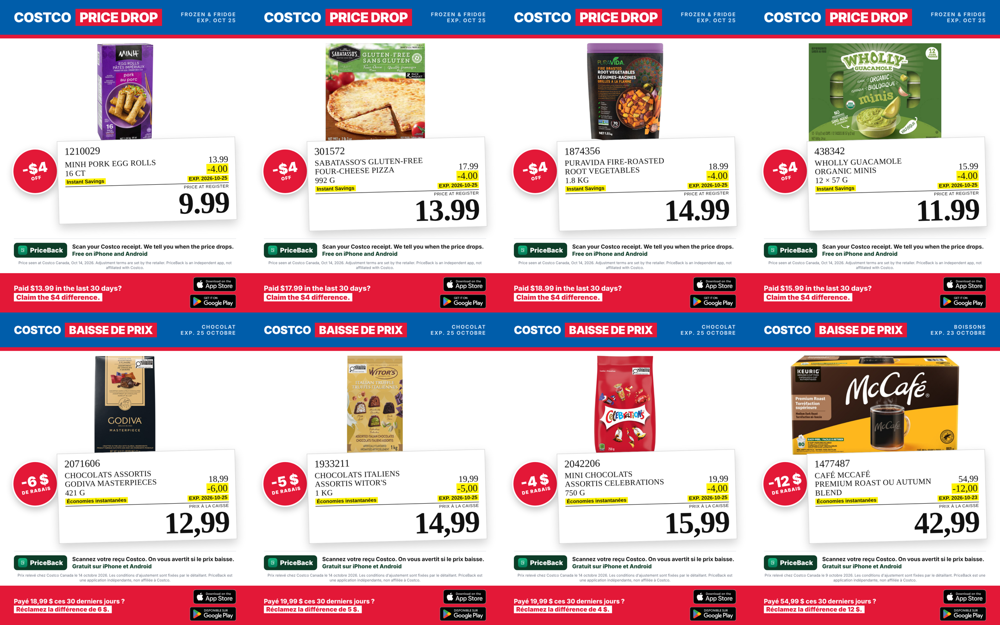

# 08-costco-price-drops: the house style for content

**This is the main style for new PriceBack posts** (chosen by Monica, 2026-10-15). Unless a brief says
otherwise, new content is a Costco price drop in this format: a clean product photo, a recreated Costco
shelf tag with the real numbers, Costco's red, blue and white, a red band that tells shoppers who
already paid full price to claim the difference, and the App Store and Google Play badges to download
PriceBack. **One item per image, always. A category is a carousel** (Monica, 2026-10-15).

| | |
| --- | --- |
| Weekly carousels | [`posts/<week>/<category>/`](posts): `<nn>-<item>-<lang>.png`, 1080×1350, in slide order |
| Data | [`scenes/weeks/<week>.json`](scenes/weeks): one file per week, every number copied from the database. [`scenes/drops.json`](scenes/drops.json) holds the first three samples |
| Render | `node sm-content/08-costco-price-drops/scenes/render.js weeks/2026-10-16.json [carousel]` (needs Playwright) |
| Product photos | Costco Same-Day packshots, cached in `scenes/.cache/<item>.jpg` (gitignored) |

## The look

| Element | Rule |
| --- | --- |
| Palette | Costco blue `#005DAA` top band, red `#E31837` stripe, box and bottom band, white field, shelf-tag yellow `#FFF200` highlight. PriceBack green appears only on the PriceBack chip. |
| Top band | `COSTCO` + red box `PRICE DROP` / `PRICE DROPS` (FR `BAISSE DE PRIX` / `BAISSES DE PRIX`). Right side: category and the savings end date (single) or total savings (category). |
| Product photo | The official packshot, white background, trimmed and centred. **Never** a shelf photo, a blurry crop or a brand-name placeholder: no clean photo, no post. |
| Shelf tag | A recreation of the Costco tag: item number, uppercase name, regular price, yellow `-x.xx`, `Instant Savings` + `EXP.` date, `PRICE AT REGISTER`, the big price. Serif numbers, like the real tag. |
| Badge | Single posts only: a red circle with `-$6 OFF` (FR `-6 $ DE RABAIS`) on the tag's left. |
| Download row | Above the fine print: the PriceBack chip, `Scan your Costco receipt. We tell you when the price drops.` / `Free on iPhone and Android` (FR `Scannez votre reçu Costco. On vous avertit si le prix baisse.` / `Gratuit sur iPhone et Android`). |
| Bottom band | Red. `Paid $19.99 in the last 30 days?` / `Claim the $6 difference.`, with Apple's and Google's official download badges on the right (unaltered artwork from `../06-launch/badges/`; Google's French badge on FR, Apple's English one until `app-store-fr.svg` is added there). |
| Fine print | Above the band, on every post: where and when the price was seen, that adjustment terms are the retailer's, and the not-affiliated line. |

## Layouts

- **One item per image, always.** Every slide is the single layout: one product, big photo, big tilted tag, badge.
- **A category is a carousel**: Frozen & fridge, Drinks, Pantry, Chocolate, Snacks and so on, whatever the week's
  savings support. Slides run from the biggest saving to the smallest. The top band names the category.
- The two-or-three-products category layout (`"layout": "category"` in `drops.json`) is retired; it stays in the
  renderer only so the first samples re-render.

## Making a week's carousels

1. **Prices come from the PriceBack database only** (Monica, 2026-10-15), never from Same-Day or a flyer page.
   Pull Costco `priceback.price_points` that are on sale, cheaper than regular, and valid at least 5 days past the
   posting date. Keep an item only when every province carries the same regular and sale price. Copy `regular`,
   `price`, `exp` (earliest `valid_until`), `seen` (latest `observed_at`) and the province list into
   `weeks/<posting date>.json`; `off` is `regular − price`.
2. **Languages follow the provinces** (Monica, 2026-10-15): a national saving (`"provinces": "all"`) goes out in
   EN and FR; a Quebec-only saving in FR; a saving only outside Quebec in EN. The renderer applies this per slide,
   and the fine print names the provinces when the saving is regional.
3. **Group into categories**, one carousel each, 3 to 6 items, food first.
4. **Photos come from Same-Day, nothing else.** Product pages redirect automated visits, so search
   `sameday.costco.ca/store/costco-canada/search/<item number or name>` and take the packshot from the matching
   tile, then save it as `scenes/.cache/<item number>.jpg` with the `sameday` id in the week file. Check every
   photo by eye: a search that misses returns unrelated "popular" tiles. No exact product, no slide.
5. Write the tag lines in EN and FR (size from the package), render, and look at every slide in both languages.
   EN and FR go out as separate carousels (playbook §5).

## Rules this style keeps

- **Claim, never get** (playbook §7). The band says *claim the difference*; the store decides.
- **Real numbers only.** Every price comes from a shelf tag or a verified price point, with the date it was seen.
  Don't post a drop whose `EXP.` date has passed.
- **French is localised**, not translated: `19,99 $`, `PRIX À LA CAISSE`, `Économies instantanées`.
- **No Costco logo, ever.** `COSTCO` is set in plain type, never their wordmark.

## The deliberate exception

The playbook (§7) says that where a store is named there should be "no styling that reads as official". This style
uses Costco's colours on purpose so the posts read as Costco at a glance, which was the brief. What keeps it on the
right side: no Costco logo or wordmark, PriceBack's chip on every post, and the not-affiliated line rendered into
the art. **Before any of these run as paid Meta ads, have someone qualified review the creative** (playbook §7).

## Product photos and copyright

The packshots belong to the brands and are served by Costco's Same-Day site. They are cached locally to render and
the repo keeps only the finished posts, never the raw images.
