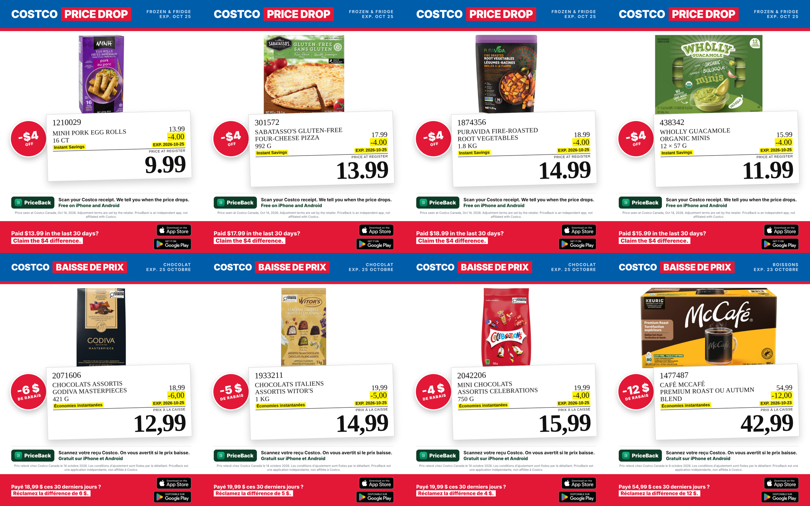

# 08-costco-price-drops: the house style for content

**This is the main style for new PriceBack posts** (chosen by Monica, 2026-10-15). Unless a brief says
otherwise, new content is a Costco price drop in this format: a clean product photo, a recreated Costco
shelf tag with the real numbers, Costco's red, blue and white, a red band that tells shoppers who
already paid full price to claim the difference, and the App Store and Google Play badges to download
PriceBack. **One item per image, always. A category is a carousel** (Monica, 2026-10-15).

| | |
| --- | --- |
| Weekly carousels | [`posts/<week>/<lang>/<category>/`](posts): `<nn>-<item>.png`, 1080×1350, in slide order. EN and FR never share a folder |
| Data | [`scenes/weeks/<week>.json`](scenes/weeks): one file per week, every number copied from the database. [`scenes/drops.json`](scenes/drops.json) holds the first three samples |
| Render | `node sm-content/08-costco-price-drops/scenes/render.js weeks/2026-10-16.json [carousel]` (needs Playwright) |
| Product photos | Costco Same-Day packshots, cached in `scenes/.cache/<item>.jpg` (gitignored) |

## The look

| Element | Rule |
| --- | --- |
| Palette | Costco blue `#005DAA` top band, red `#E31837` stripe, box and bottom band, white field, shelf-tag yellow `#FFF200` highlight. PriceBack green appears only on the PriceBack chip. |
| Top band | `COSTCO` + red box `PRICE DROP` / `PRICE DROPS` (FR `BAISSE DE PRIX` / `BAISSES DE PRIX`). Right side: category and the savings end date (single) or total savings (category). |
| Product photo | The official packshot, white background, trimmed and centred. **Never** a shelf photo, a blurry crop or a brand-name placeholder: no clean photo, no post. |
| Shelf tag | A recreation of the Costco tag: item number, uppercase name, regular price, yellow `-x.xx`, `Instant Savings` + `EXP.` date, `PRICE AT REGISTER`, the big price. Serif numbers, like the real tag. |
| Badge | Single posts only: a red circle with `-$6 OFF` (FR `-6 $ DE RABAIS`) on the tag's left. |
| Download row | Above the fine print: the PriceBack chip, `Scan your Costco receipt. We tell you when the price drops.` / `Free download, with a free trial` (FR `Scannez votre reçu Costco. On vous avertit si le prix baisse.` / `Téléchargement gratuit, avec essai gratuit`; never call the app "free"). |
| Bottom band | Red. `Paid $19.99 in the last 30 days?` / `Claim the $6 difference.`, with Apple's and Google's official download badges on the right (unaltered artwork from `../06-launch/badges/`; Google's French badge on FR, Apple's English one until `app-store-fr.svg` is added there). |
| Fine print | Above the band, on every post: where and when the price was seen, that adjustment terms are the retailer's, and the not-affiliated line. |

## Layouts

- **One item per image, always.** Every slide is the single layout: one product, big photo, big tilted tag, badge.
- **A category is a carousel**: Frozen & fridge, Drinks, Pantry, Chocolate, Snacks and so on, whatever the week's
  savings support. Slides run from the biggest saving to the smallest. The top band names the category.
- The two-or-three-products category layout (`"layout": "category"` in `drops.json`) is retired; it stays in the
  renderer only so the first samples re-render.

## Making a week's carousels

1. **Prices come from the PriceBack database only** (Monica, 2026-10-15), never from Same-Day or a flyer page.
   Pull Costco `priceback.price_points` that are on sale, cheaper than regular, and valid at least 5 days past the
   posting date. Keep an item only when every province carries the same regular and sale price. Copy `regular`,
   `price`, `exp` (earliest `valid_until`), `seen` (latest `observed_at`) and the province list into
   `weeks/<posting date>.json`; `off` is `regular − price`.
   **Hidden savings only** (Monica, 2026-10-15): the point is savings that are *not* in the official Costco flyer.
   Drop every item that has a price point with source type `flyer` or appears in the flyer
   (flipp.com/search/costco; check Flipp *before* rendering, through `backflipp.wishabi.com/flipp/items/search?q=costco&postal_code=…` and `/flipp/flyers/<id>`). Use the Same-Day weekly savings collection
   (`sameday.costco.ca/store/costco-canada/collections/rc-weekly-savings`) to find more savings, and cross-check
   each item's saving and "Ends" date on its Same-Day product page against the database. Post only items where
   both agree; list every disagreement with the Same-Day date in the week's `Same-Day-vs-database.md` so the
   database can be corrected. Same-Day prices are Instacart prices: compare the saving, never the price.
2. **English and French carry the exact same offers** (Monica, 2026-10-29; replaces "languages follow the
   provinces"). Language is never chosen by province, even for a saving seen only in Alberta or only in Quebec.
   Every product gets **one post**, never one per province, with the **province strip under the product photo**:
   every province with a Costco, the ones where the saving was seen filled in, the rest greyed and struck through.
3. **Group deals by saving range, then product category, then location** (Monica, 2026-10-29; full rule in `../../RULES-README.md`). Location: Costco warehouses or Business Centre, never mixed without where-to-buy on the post; the strip shows Business-Centre-only provinces in yellow. Saving ranges: $400–$1,100 off, $300–$400 off, $150–$300 off, under
   $150 off, never by the item's price. **Groceries are the exception**: by type (coffee & drinks, frozen & meat,
   dairy & cheese, pantry & snacks…). Within a carousel, slides run from the biggest saving to the smallest.
   To post the week as **one carousel per language** instead (Monica, 2026-10-15), add
   `"feeds": {"en": [category ids…], "fr": [category ids…]}` to the week file: the renderer then writes
   `posts/<week>/<lang>/00-cover.png` (hook, the six biggest savings one per brand, swipe cue) followed by every
   item of those categories that goes out in that language, with carousel dots in the red band on every slide.
   Keep each carousel at 20 slides or fewer (Instagram's limit).
4. **Photos come from Same-Day, nothing else.** Product pages redirect automated visits, so search
   `sameday.costco.ca/store/costco-canada/search/<item number or name>` and take the packshot from the matching
   tile, then save it as `scenes/.cache/<item number>.jpg` with the `sameday` id in the week file. Check every
   photo by eye: a search that misses returns unrelated "popular" tiles. No exact product, no slide.
5. Write the tag lines in EN and FR (size from the package), render, and look at every slide in both languages.
   EN and FR go out as separate carousels (playbook §5).

## Grocery carousels (Monica, 2026-11-04)

Full rule list: `../../RULES-README.md` §1. In short: four categories (Grocery, Home, Health & Beauty, Frozen),
savings that started this week only, never an item already posted, grouped and ordered by end date, at most 8
offers per carousel, EN + FR, province strip on every item, the claim cover, the end card last.

- Week file: `"coverStyle": "claim"` renders the claim cover (`claimCover()` in `render.js`): "Costco Canada
  Drops 🇨🇦" small on top, "New drops / Claim until / Sunday, / Nov 15" huge in the middle, the drop count
  medium below, "Bought in the last 30 days?" small and yellow in the red band. No swipe cue.
- Location query (the Oct 27 bug fix): classify each price point as Business Centre when
  `flags->>'storefront' = 'business_centre'` or the warehouse name matches `%business%`, else warehouse; a
  province goes in `provinces` only if it has a warehouse row, in `bizOnly` if it has Business Centre rows only.
- Photos: Same-Day search by item number (`sameday.costco.ca/store/costco-canada/s?k=<item #>` in headless
  Chromium; search shows the store's region, so western-only items may miss) or costco.ca
  (`gdx-assets.costco.com/.../<item #>-894__1.jpg`). Check every photo by eye. No clean photo, no post.
- Cover (latest, 2026-11-04): total line on two lines without "all"; "8 price drops" clearly bigger than the date
  (date 100px, count 124px; FR 92/104); red footer "Bought in the last 30 days?" + white box "CLAIM UP TO $X BACK".
- Item slides: `"bigClaim": true` → red footer "PAID $X in the last 30 days?" + white box "CLAIM $Y BACK" (the
  `.huge` class). Category in the top band white, bold, 30px.
- Business Centre carousels are separate: `"businessCentre": true` adds the yellow "Only in Costco Business
  Centres" ribbon on the cover.
- Item choice: everyday staples with the highest savings first, then other groceries, then smaller savings;
  anything over $2 off beats a $2 item. A bigger saving always wins over "everyday"; everyday only breaks ties.
- End card: yellow line "+ hundreds more hidden savings, only in the PriceBack app" under the subline (`endMore`). Query:
  `valid_from` ≥ the week's Monday and `created_at` ≥ that Monday.
- Reels come only after Monica validates the slides. Every remark Monica makes is added as a rule here and in
  `RULES-README.md` §1.

## Rules this style keeps

- **Claim, never get** (playbook §7). The band says *claim the difference*; the store decides.
- **Real numbers only.** Every price comes from a shelf tag or a verified price point, with the date it was seen.
  Don't post a drop whose `EXP.` date has passed.
- **French is localised**, not translated: `19,99 $`, `PRIX À LA CAISSE`, `Économies instantanées`.
- **No Costco logo, ever.** `COSTCO` is set in plain type, never their wordmark.

## The deliberate exception

The playbook (§7) says that where a store is named there should be "no styling that reads as official". This style
uses Costco's colours on purpose so the posts read as Costco at a glance, which was the brief. What keeps it on the
right side: no Costco logo or wordmark, PriceBack's chip on every post, and the not-affiliated line rendered into
the art. **Before any of these run as paid Meta ads, have someone qualified review the creative** (playbook §7).

## Product photos and copyright

The packshots belong to the brands and are served by Costco's Same-Day site. They are cached locally to render and
the repo keeps only the finished posts, never the raw images.
- Reels (Monica, 2026-11-04 18:10): no text over product photos; the end date gets its own designed badge/zone;
  name the category ("GROCERY") in the hook; propose hook options before regenerating when the top drop is small;
  end card names the app once as "ONLY in [logo PriceBack]"; "HIDDEN" in bold capitals; music = trending
  Instagram audio added at posting (we deliver a no-music copy), not synth tracks.
- **Approved default reel design (Monica, 2026-11-04 21:13):** `reels/follower-reel.js` v5, spec in `reels/README.md`.
  Use it automatically for every future reel of this format.
